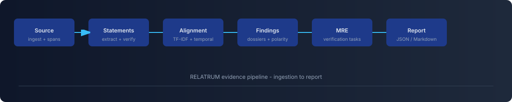
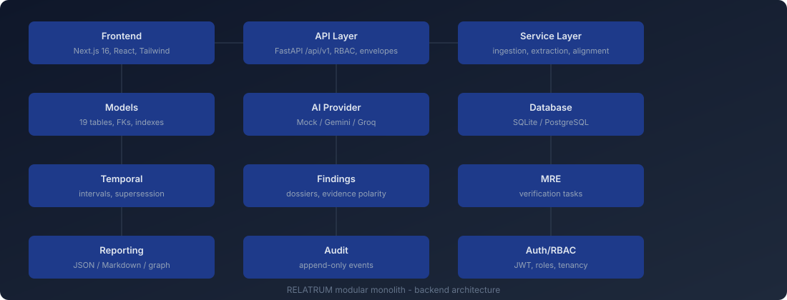

# RELATRUM


> Where expectations meet evidence.

[](#testing)
[](#tech-stack)
[](#tech-stack)
[](#license)

RELATRUM is an evidence intelligence platform that turns fragmented organizational information into a structured, traceable, time-aware evidence system. It identifies possible divergence between official requirements and real-world observations, preserves uncertainty and counter-evidence, and proposes the minimum evidence needed to resolve each finding.

---

## Highlights

- Bidirectional alignment: requirement to observation and observation to requirement.
- Temporal reasoning: effective dates, interval overlap, supersession, unknown-safe (no implicit infinity).
- Counter-evidence preservation: conflicting evidence is never discarded.
- Finding dossiers: structured evidence with polarity, quality profile, review history.
- Minimum Resolving Evidence (MRE): targeted verification tasks and responses.
- Reports and graph: JSON/Markdown export and evidence graph.
- Responsible AI: findings are candidates requiring human review; mock mode is deterministic and offline.
- Multi-tenant: workspaces, RBAC (owner/editor/reviewer/viewer), workspace isolation.

---


## Architecture

```
+-----------+        +------------------+        +----------------------+
|   User    | -----> | Next.js Frontend | -----> | FastAPI /api/v1      |
+-----------+        +------------------+        +----------+-----------+
                                                          |
                                                          v
                                               +----------+-----------+
                                               |     Service Layer    |
                                               |  ingestion, extract  |
                                               |  alignment, temporal |
                                               |  findings, MRE, ...  |
                                               +----+-----------+-----+
                                                    |           |
                                                    v           v
                                          +---------+--+  +-----+-----------+
                                          | SQLite / PG |  | AI Provider     |
                                          +-------------+  | Mock (default)  |
                                                          | Gemini / Groq   |
                                                          +-----------------+
```

The backend is a modular monolith: routers, services, models, and AI providers are separated by responsibility. Every analysis is reproducible (manifest hash, run metadata) and all findings are evidence-grounded.

See the full [Architecture document](docs/architecture.md) for module responsibilities, data flow, tenancy, and deployment.

---

## Quick start

### Backend

```bash
cd backend
python -m venv .venv
.venv\Scripts\activate
pip install -r requirements.txt
copy .env.example .env
python -m uvicorn app.main:app --port 8000
```

- OpenAPI: http://localhost:8000/docs
- Health: http://localhost:8000/health/ready

### Frontend

```bash
cd frontend
npm install
copy .env.example .env.local
npm run dev
```

Open http://localhost:3000

### Tests

```bash
cd backend
python -m pytest        # 100 passed
```

```bash
cd frontend
npm run build            # production build
npm run lint              # 0 errors
```

---

## Pipeline



## Architecture diagram



## Documentation

| Document | Description |
|----------|-------------|
| [Architecture](docs/architecture.md) | Modules, data flow, tenancy, providers |
| [Data Dictionary](docs/data-dictionary.md) | All 19 tables and fields |
| [AI Methodology](docs/ai-methodology.md) | Extraction, alignment, temporal, MRE, quality |
| [Evaluation](docs/evaluation.md) | Synthetic dataset and test results |
| [Privacy](docs/privacy.md) | Data handling and security |
| [Backend README](backend/README.md) | Backend-specific setup and API |
| [Frontend README](frontend/README.md) | Frontend setup and pages |

---

## Tech stack

Backend: Python 3.11+, FastAPI, Pydantic v2, SQLAlchemy 2.x, Alembic, SQLite/PostgreSQL, scikit-learn, RapidFuzz.

Frontend: Next.js 16, React 19, TypeScript (strict), Tailwind CSS 4.

AI: Mock (default, deterministic, offline), Gemini, Groq via provider interface.

---

## Testing

- Backend: pytest, 100 tests (ingestion, extraction, alignment, temporal, findings, MRE, reporting, graph, RBAC).
- Frontend: npm run build + npm run lint.

---

## Project structure

```text
relatrum/
├── backend/          # FastAPI backend
├── frontend/         # Next.js frontend
├── docs/             # Architecture, data dictionary, methodology, evaluation, privacy
└── README.md
```

---

## Responsible AI

- Findings are candidates requiring human review, never auto-proven violations.
- Absence of evidence is not evidence of non-compliance.
- Mock mode is deterministic heuristics, disclosed as such in system info and reports.
- No causal claims without explicit evidence.
- All outputs traceable to source spans.

---

## License

Proprietary / internal project.
