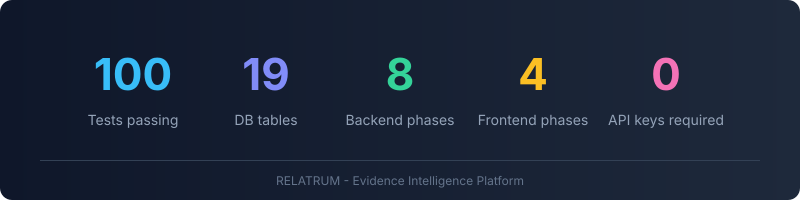
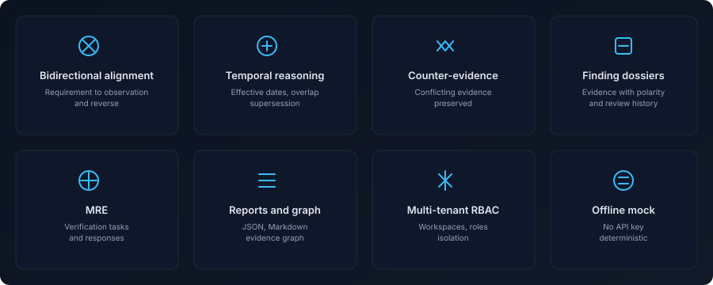
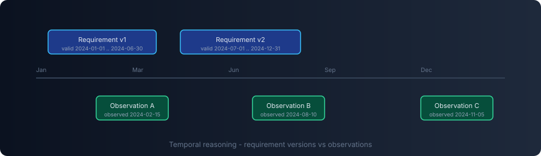
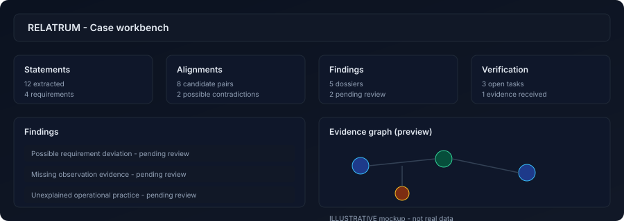
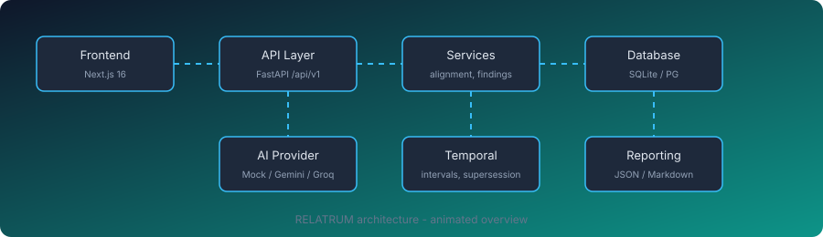
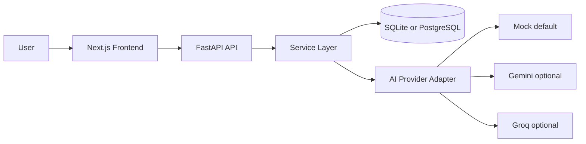

<div align="center">



<br>

[](https://github.com/idansajah71-blip/relatrum/actions)
[](https://github.com/idansajah71-blip/relatrum/releases)
[](https://github.com/idansajah71-blip/relatrum/stargazers)
[](#license)
[](#testing)

<!-- Dynamic badges (replace OWNER/REPO): -->
<!--  -->
<!--  -->
<!--  -->

<br>


<br>



<br>

<a href="#overview"><b>Overview</b></a> &nbsp;|&nbsp;
<a href="#capabilities"><b>Capabilities</b></a> &nbsp;|&nbsp;
<a href="#how-it-works"><b>How It Works</b></a> &nbsp;|&nbsp;
<a href="#architecture"><b>Architecture</b></a> &nbsp;|&nbsp;
<a href="#quick-start"><b>Quick Start</b></a> &nbsp;|&nbsp;
<a href="#documentation"><b>Documentation</b></a>

</div>

<br>


<br>

<details>
<summary><b>Table of contents</b></summary>

- [Overview](#overview)
- [Capabilities](#capabilities)
- [How It Works](#how-it-works)
- [Core Concepts](#core-concepts)
- [Unique Concept](#unique-concept)
- [Preview](#preview)
- [Architecture](#architecture)
- [Quick Start](#quick-start)
- [Configuration](#configuration)
- [Troubleshooting](#troubleshooting)
- [AI Providers](#ai-providers)
- [Roles and Permissions](#roles-and-permissions)
- [API Overview](#api-overview)
- [Testing](#testing)
- [Documentation](#documentation)
- [Tech Stack](#tech-stack)
- [Project Structure](#project-structure)
- [Responsible AI and Security](#responsible-ai-and-security)
- [FAQ](#faq)
- [License](#license)

</details>

<br>


<br>

## Overview

Organizations constantly say one thing on paper and live another in practice. Requirements sit in one place, observations in another, and finding where they diverge is slow, manual, and easy to get wrong.

RELATRUM is an evidence intelligence platform that closes that gap. It turns fragmented organizational information into a structured, traceable, time-aware evidence system, then:

- identifies possible divergence between official requirements and real-world observations,
- preserves uncertainty and counter-evidence instead of hiding it,
- proposes the minimum evidence needed to resolve each finding.

> RELATRUM never declares a violation on its own. Every finding is a candidate for human review.

<br>


<br>

## Capabilities



- Bidirectional alignment: requirement to observation and observation to requirement.
- Temporal reasoning: effective dates, interval overlap, supersession, unknown-safe (no implicit infinity).
- Counter-evidence preservation: conflicting evidence is never discarded.
- Finding dossiers: structured evidence with polarity, quality profile, review history.
- Minimum Resolving Evidence: targeted verification tasks with competing hypotheses and expected answer structure.
- Reports and graph: JSON/Markdown export and evidence graph.
- Multi-tenant workspaces with RBAC (owner/editor/reviewer/viewer).
- Offline mock mode: deterministic, no API key required.

<br>


<br>

## How It Works

1. Create a workspace and an investigation case.
2. Import official requirements, policy documents, or procedures.
3. Import real-world reports or observations.
4. Extract source passages and atomic statements with exact evidence spans.
5. Normalize statements.
6. Identify candidate relationships via TF-IDF and fuzzy matching.
7. Perform bidirectional alignment.
8. Evaluate temporal relationships.
9. Identify possible divergence.
10. Search for supporting and counter-evidence.
11. Generate structured finding dossiers.
12. Generate Minimum Resolving Evidence requests.
13. Human reviewer verifies or rejects findings.
14. Preserve review history.
15. Generate an evidence-grounded report.

<details>
<summary><b>Stage details</b></summary>

- Ingestion validates file size, MIME type, and hash; preserves original documents and versions.
- Extraction rejects fabricated quotes; every statement links to at least one evidence span.
- Alignment classifies pairs: full match, partial match, possible contradiction, temporal mismatch, insufficient information, uncertain, unrelated.
- Temporal reasoning treats unknown bounds as unknown, never as implicit infinity.
- Findings are deduplicated by stable finding code; new runs supersede (not overwrite) prior findings.
- MRE produces targeted questions, competing hypotheses, and expected answer structures.

</details>

<br>


<br>

## Core Concepts

- **Evidence span**: the fundamental provenance unit (exact quote + char offsets).
- **Statement**: one meaningful, independently analyzable unit with subject, actor, action, object, modality, temporal bounds.
- **Alignment**: requirement-observation candidate with lexical/semantic similarity and temporal compatibility.
- **Finding**: structured evidence dossier, not a proven violation.
- **MRE (Minimum Resolving Evidence)**: the smallest useful verification request to distinguish competing explanations.
- **Quality profile**: extraction_quality, evidence_coverage, temporal_alignment_quality, semantic_alignment_quality, source_diversity, counter_evidence_presence, reviewer_validation_status.

<br>


<br>

## Unique Concept



RELATRUM's signature interaction is **Minimum Resolving Evidence**: when evidence is insufficient, the system identifies what additional information would most efficiently clarify the finding, including competing hypotheses and what different answers would establish. Absence of evidence is never treated as evidence of non-compliance.

<br>


<br>

## Preview

> ILLUSTRATIVE mockup. Not real data.



<!-- Screenshot placeholders (add real screenshots here):


-->

<!-- Demo GIF placeholder:

-->

<br>


<br>

## Architecture





The backend is a modular monolith: routers, services, models, and AI providers are separated by responsibility. Every analysis is reproducible (manifest hash, run metadata) and all findings are evidence-grounded.

See the full [Architecture document](docs/architecture.md).

<br>


<br>

## Quick Start

<details>
<summary><b>Windows (PowerShell)</b></summary>

```powershell
cd backend
python -m venv .venv
.venv\Scripts\activate
pip install -r requirements.txt
copy .env.example .env
python -m uvicorn app.main:app --port 8000

cd ..\frontend
npm install
copy .env.example .env.local
npm run dev
```

</details>

<details>
<summary><b>macOS / Linux</b></summary>

```bash
cd backend
python -m venv .venv
source .venv/bin/activate
pip install -r requirements.txt
cp .env.example .env
python -m uvicorn app.main:app --port 8000

cd ../frontend
npm install
cp .env.example .env.local
npm run dev
```

</details>

- OpenAPI: http://localhost:8000/docs
- Frontend: http://localhost:3000

<br>


<br>

## Configuration

Backend environment variables (`backend/.env`):

```env
APP_ENV=development
DATABASE_URL=sqlite:///./relatrum.db
AI_PROVIDER=mock
GEMINI_API_KEY=
GROQ_API_KEY=
MAX_UPLOAD_MB=10
MAX_DOCUMENT_PAGES=100
LLM_MAX_CALLS_PER_ANALYSIS=5
AI_TIMEOUT_SECONDS=45
```

Frontend (`frontend/.env.local`):

```env
NEXT_PUBLIC_API_URL=http://localhost:8000
```

<br>


<br>

## Troubleshooting

<details>
<summary><b>Backend does not start</b></summary>

- Check Python version (3.11+).
- Verify `.env` exists and `DATABASE_URL` is valid.
- Run `pip install -r requirements.txt`.

</details>

<details>
<summary><b>Tests fail on database lock</b></summary>

- Ensure no other process holds `_test_rel.db`.
- Delete `_test_rel.db`, `-wal`, `-shm` and rerun.

</details>

<details>
<summary><b>Frontend cannot reach backend</b></summary>

- Confirm backend runs on port 8000.
- Check `NEXT_PUBLIC_API_URL` in `frontend/.env.local`.

</details>

<details>
<summary><b>Mermaid diagram does not render</b></summary>

GitHub occasionally fails to render Mermaid. A static ASCII diagram is provided as fallback in the Architecture section.

</details>

<br>


<br>

## AI Providers

- **Mock** (default): deterministic, offline, no API key. Disclosed in system info and reports.
- **Gemini**: optional, set `GEMINI_API_KEY` and `AI_PROVIDER=gemini`.
- **Groq**: optional, set `GROQ_API_KEY` and `AI_PROVIDER=groq`.
- Keys are server-side only, never exposed to frontend.

<br>


<br>

## Roles and Permissions

- **viewer**: read-only access.
- **editor**: create sources, run extraction and analysis.
- **reviewer**: review findings, update verification tasks.
- **owner**: full workspace control.

Non-members receive 404 to hide existence. Insufficient role receives 403.

<br>


<br>

## API Overview

| Resource | Endpoints |
|----------|-----------|
| Workspaces / Cases | `/api/v1/workspaces`, `/api/v1/workspaces/{id}/cases`, `/api/v1/cases/{id}` |
| Sources | `/api/v1/cases/{id}/sources`, `/api/v1/sources/{id}`, `/api/v1/sources/{id}/extract` |
| Statements | `/api/v1/cases/{id}/statements`, `/api/v1/statements/{id}` |
| Analysis | `/api/v1/cases/{id}/analyze`, `/api/v1/cases/{id}/alignments`, `/api/v1/analysis-runs/{id}` |
| Findings | `/api/v1/cases/{id}/findings`, `/api/v1/findings/{id}`, `/evidence`, `/history`, `/status` |
| Verification | `/api/v1/findings/{id}/verification`, `/api/v1/verification/{id}`, `/responses`, `/api/v1/cases/{id}/verification-queue` |
| Reports / Graph | `/api/v1/cases/{id}/reports`, `/api/v1/cases/{id}/graph` |
| System | `/api/v1/system/info`, `/api/v1/system/providers` |

All responses use the envelope `{ success, message, data, meta }`.

<br>


<br>

## Testing

```bash
cd backend
python -m pytest        # 100 passed
```

```bash
cd frontend
npm run build            # production build
npm run lint              # 0 errors
```

<br>


<br>

## Documentation

| Document | Description |
|----------|-------------|
| [Architecture](docs/architecture.md) | Modules, data flow, tenancy, providers |
| [Data Dictionary](docs/data-dictionary.md) | All 19 tables and fields |
| [AI Methodology](docs/ai-methodology.md) | Extraction, alignment, temporal, MRE, quality |
| [Evaluation](docs/evaluation.md) | Synthetic dataset and test results |
| [Privacy](docs/privacy.md) | Data handling and security |
| [Backend README](backend/README.md) | Backend-specific setup and API |
| [Frontend README](frontend/README.md) | Frontend setup and pages |

<br>


<br>

## Tech Stack

Backend: Python 3.11+, FastAPI, Pydantic v2, SQLAlchemy 2.x, Alembic, SQLite/PostgreSQL, scikit-learn, RapidFuzz.

Frontend: Next.js 16, React 19, TypeScript (strict), Tailwind CSS 4.

AI: Mock (default, deterministic, offline), Gemini, Groq via provider interface.

Icons: Lucide (MIT) for capability icons. Badges by shields.io. Header/footer by capsule-render.

<p align="center">
  
</p>

<br>


<br>

## Project Structure

```text
relatrum/
├── backend/          # FastAPI backend
├── frontend/         # Next.js frontend
├── docs/             # Architecture, data dictionary, methodology, evaluation, privacy
├── docs/assets/      # SVG assets (banner, stats, pipeline, capabilities, concept, preview, divider, architecture, animated-architecture)
└── README.md
```

<br>


<br>

## Responsible AI and Security

- Findings are candidates requiring human review, never auto-proven violations.
- Absence of evidence is not evidence of non-compliance.
- Mock mode is deterministic heuristics, disclosed as such in system info and reports.
- No causal claims without explicit evidence.
- All outputs traceable to source spans.
- API keys server-side only; uploaded content treated as untrusted.

<br>


<br>

## FAQ

<details>
<summary><b>Does RELATRUM require an API key?</b></summary>

No. Default mode is `AI_PROVIDER=mock`, which runs fully offline with deterministic rule-based processing. Gemini and Groq are optional enhancements.

</details>

<details>
<summary><b>Are findings proof of non-compliance?</b></summary>

No. Findings are candidates requiring human review. Absence of evidence is not evidence of non-compliance. RELATRUM is decision support, not an accusation engine.

</details>

<details>
<summary><b>How is reproducibility ensured?</b></summary>

Each analysis creates an analysis run with pipeline, prompt, provider, and model versions plus an input manifest hash (SHA-256). Findings carry the originating run and supersession links. Review and audit trails are append-only.

</details>

<details>
<summary><b>Can I use PostgreSQL instead of SQLite?</b></summary>

Yes. Models are Postgres-portable. Set `DATABASE_URL` to a PostgreSQL connection string and run Alembic migrations.

</details>

<br>


<br>

## License

Proprietary / internal project.

<br>

<div align="center">

</div>
