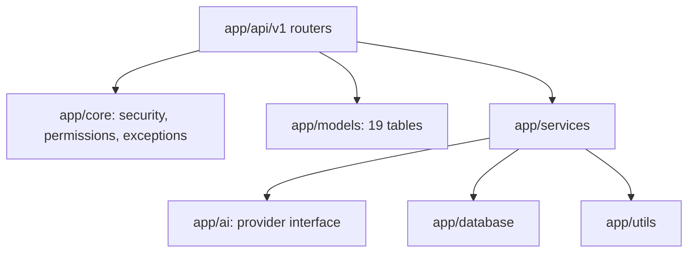
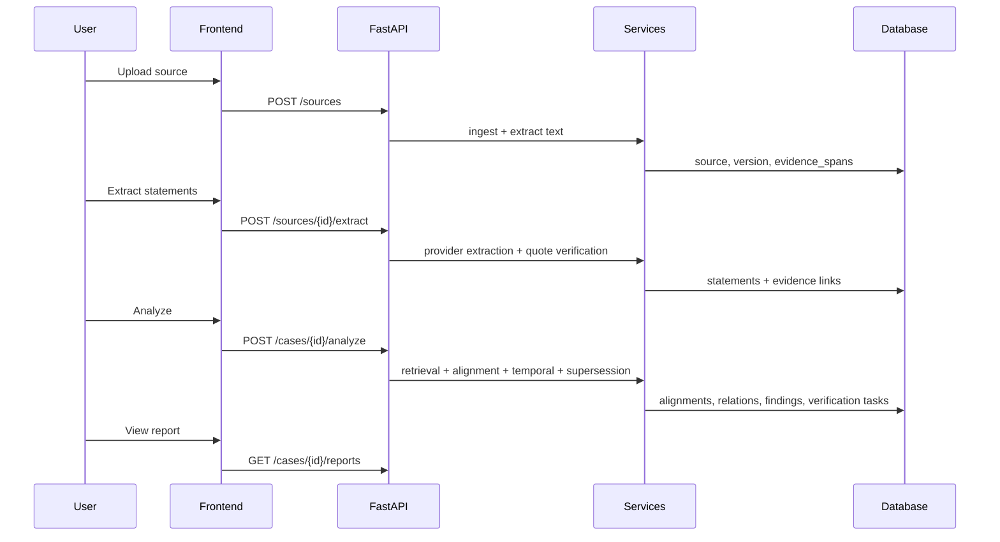
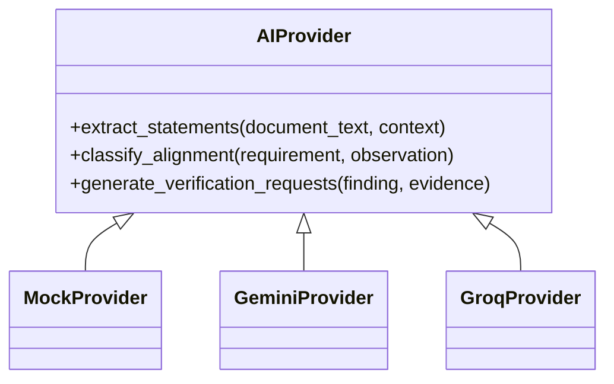

# Architecture

RELATRUM is a modular monolith: a FastAPI backend with a Next.js frontend, designed backend-first and optimized for low-resource environments.

## System overview

```mermaid
flowchart LR
    U[User] --> FE[Next.js Frontend]
    FE --> API[FastAPI /api/v1]
    API --> SVC[Service Layer]
    SVC --> DB[(SQLite / PostgreSQL)]
    SVC --> AI[AI Provider Adapter]
    AI --> MOCK[Mock (default)]
    AI --> GEMINI[Gemini (optional)]
    AI --> GROQ[Groq (optional)]
```

## Backend layers



## Module responsibilities

| Module | Responsibility |
|--------|----------------|
| `api/v1` | HTTP endpoints, validation, RBAC, envelope responses |
| `core` | JWT auth, permissions, exceptions, logging, config |
| `models` | Normalized relational schema, FKs, indexes |
| `services/ingestion` | File validation, hashing, text extraction, provenance spans |
| `services/extraction` | Atomic statement extraction, quote verification |
| `services/normalization` | Statement normalization |
| `services/alignment` | TF-IDF + fuzzy candidate retrieval, classification |
| `services/temporal` | Interval overlap, applicability, supersession |
| `services/divergence` | Detection of divergence patterns |
| `services/findings` | Dossier persistence, dedup, review transitions |
| `services/verification` | MRE tasks and responses |
| `services/reporting` | JSON/Markdown reports |
| `services/graph` | Evidence graph data |
| `services/orchestration` | Analysis run orchestration, manifest hash |
| `services/audit` | Append-only audit events |
| `ai` | Provider interface (Mock/Gemini/Groq), prompts, usage |
| `utils` | Hashing, text folding, dates |

## Data flow



## Domain model (core entities)

- **Workspace** → **Case** → **Source** → **SourceVersion** → **EvidenceSpan**
- **Statement** (atomic) ↔ **StatementEvidence** ↔ **EvidenceSpan**
- **Alignment** (requirement ↔ observation) with temporal compatibility
- **Finding** (dossier) ↔ **FindingEvidence** (polarity: supports/contradicts/context/unresolved)
- **VerificationTask** ↔ **VerificationResponse** (MRE)
- **Review** (append-only history)
- **AnalysisRun** + **AiInvocation** (reproducibility)
- **AuditEvent** (append-only)

## Tenancy and security

- Every workspace-owned resource scoped by `workspace_id`.
- `require_workspace_member` enforces RBAC: viewer < editor < reviewer < owner.
- Non-members receive 404 to hide existence.
- API keys server-side only; uploaded content treated as untrusted.

## Reproducibility

Each analysis creates an `analysis_run` capturing:
- pipeline_version, prompt_version, provider_name, model_name
- input_manifest_hash (SHA-256 of input corpus + engine identity)
- execution_metadata (counts, IDs, thresholds)
- started_at / completed_at

Findings carry `created_by_analysis_run` and `supersedes_finding_id` for history. Review and audit trails are append-only.

## Provider architecture



- Mock: deterministic, offline, no API key.
- External providers: optional, configured via env, with retry/timeout.

## Performance and cost

- CPU-friendly processing (TF-IDF, RapidFuzz).
- Candidate filtering reduces AI calls.
- Hash-based deduplication.
- Configurable limits (upload size, pages, LLM calls, timeout).
- No large local models; embeddings disabled by default.

## Deployment

- Backend: `uvicorn app.main:app` (port 8000).
- Frontend: `next dev` / `next start` (port 3000).
- Database: SQLite (dev) or PostgreSQL (prod) via `DATABASE_URL`.
- Migrations: Alembic (`alembic upgrade head`).

## Directory structure

```text
relatrum/
├── backend/
│   ├── app/
│   │   ├── api/v1/
│   │   ├── core/
│   │   ├── models/
│   │   ├── services/
│   │   ├── ai/
│   │   ├── utils/
│   │   └── database.py
│   ├── tests/
│   ├── migrations/
│   └── README.md
├── frontend/
│   ├── src/
│   └── README.md
├── docs/
└── README.md
```
